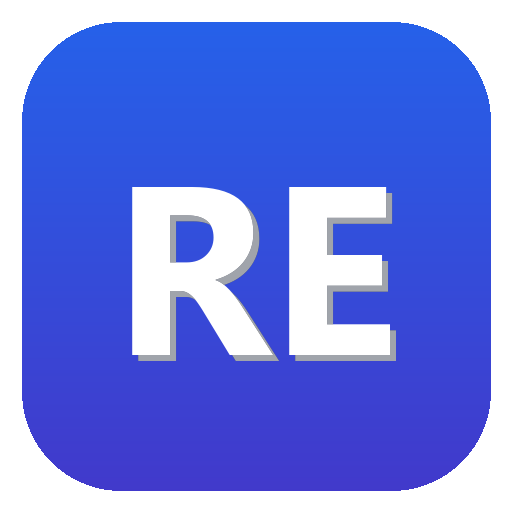

# 
 <b>RusEn</b>

  <b>Умное переключение раскладки клавиатуры и сверхбыстрый голосовой ввод без задержек для Windows 10/11</b>

  
  
  
  

---

## ⚡ Главные возможности

### 1. ⌨️ Умный CapsLock без залипания
- **Одиночный тап по CapsLock**: мгновенно переключает раскладку (RU ↔ EN) и автоматически конвертирует последнее набранное слово (например, `ghbdtn` ➔ `привет`).
- **Удержание или двойной тап**: включает классический режим ЗАГЛАВНЫХ БУКВ. Больше никаких случайных зажатий CapsLock!

### 2. 🚀 Автоматическое исправление на лету
- RusEn анализирует n-граммы и частотность символов.
- При завершении ошибочно набранного слова (нажатие **Пробел** или **Enter**) программа незаметно стирает ошибочный текст, переключает язык и впечатывает правильное слово.

### 3. 🎙️ Сверхбыстрый ввод голосом через Groq Whisper AI (<300 мс)
- **Push-to-Talk (Удержание левого Shift)** или **одиночный тап по F8**: диктуйте текст в любом окне Windows.
- Работает через ультраскоростные LPU-процессоры **Groq Cloud** с моделью `whisper-large-v3-turbo`. Распознавание русской и английской речи происходит со скоростью мысли и идеальной пунктуацией.

### 4. 📴 Менеджер офлайн-нейросетей (1-click загрузка прямо из программы)
- Хотите полную автономность без интернета и облаков?
- Откройте **Настройки** ➔ вкладку **«Модели распознавания»** и нажмите **«⬇️ Скачать»** напротив нужной модели:
  - **Sber GigaAM-v2** (~440 МБ) — флагманская российская модель для русского языка.
  - **Faster-Whisper Large Turbo** (~1.5 ГБ) — локальный мультиязычный Whisper с поддержкой CUDA GPU.
- Программа **автоматически настроит запуск под ваше оборудование** (NVIDIA CUDA или многоядерный CPU).
- Ненужную модель можно в любой момент удалить в 1 клик, освободив место на диске.

### 5. 🔄 Пул ключей Groq Round-Robin
- Добавьте несколько бесплатных ключей Groq API.
- RusEn автоматически распределяет запросы по кругу. При кратковременном исчерпании лимита (ошибка 429) программа бесшовно переключится на следующий рабочий ключ.

### 6. 🚀 Встроенное автообновление (Auto-Updater)
- Программа сама проверяет появление свежих релизов на GitHub.
- При выходе новой версии в системном трее и окне настроек появится кнопка быстрого обновления. RusEn скачает и применит обновление без необходимости ручного поиска и повторной настройки.

### 7. 🛡️ Конфиденциальность и безопасность (152-ФЗ РФ)
- Настройки и загруженные модели хранятся в защищенном каталоге `%LOCALAPPDATA%\RusEn` и сохраняются при переустановках и обновлениях.
- Программа не ведет кейлоггинг, не передает персональные данные третьим лицам и не сохраняет звук на диске.

---

## 📥 Скачивание и установка

1. Скачайте официальный установщик:
   

     
   

2. Запустите `RusEn_Setup_v1.0.6.exe` и следуйте шагам мастера установки.
3. В системном трее Windows (рядом с часами) появится иконка **RusEn**.

---

## 🔑 Как получить бесплатный ключ Groq API (за 1 минуту)

Groq предоставляет бесплатный лимит на модель Whisper Large v3 (тысячи минут распознавания в месяц):

1. Перейдите в консоль: **[console.groq.com/keys](https://console.groq.com/keys)**
2. Войдите через Google или GitHub.
3. Нажмите кнопку **«Create API Key»**, введите любое имя (например, `RusEn`) и скопируйте ключ вида `gsk_...`
4. В RusEn нажмите правой кнопкой на значок в трее ➔ **«⚙️ Настройки»** ➔ вкладка **«Ключи Groq API»** ➔ вставьте ключ и нажмите **«Добавить ключ»**.

---

## ⌨️ Горячие клавиши по умолчанию

| Клавиша / Сочетание | Действие |
| :--- | :--- |
| **Одиночный CapsLock** | Переключение языка ввода + конвертация последнего набранного слова |
| **Удержание левого Shift** | Голосовой ввод (Push-to-Talk): диктуйте, пока держите, отпустите для вставки |
| **Тап по F8** | Голосовой ввод (Toggle): первое нажатие — старт записи, второе — завершение и вставка |
| **Пробел / Enter** | Автоматическая замена ошибочно набранного слова на лету |
| **Двойной клик по иконке в трее** | Открыть окно настроек RusEn |

---

## 💬 Обратная связь и Поддержка

- **Официальный сайт:** [rusen.winserv.space](https://rusen.winserv.space)
- **Telegram автора для предложений и баг-репортов:** [@GEOHEISENBERG](https://t.me/GEOHEISENBERG)
- **Поддержать разработку (Донат):** QR-код для СБП доступен на сайте и во вкладке настроек программы.

---

## ⚖️ Отказ от ответственности (AS IS)

Программное обеспечение предоставляется на условиях «КАК ЕСТЬ» (AS IS) без явных или подразумеваемых гарантий. Автор не несет ответственности за любые косвенные убытки или несовместимость с другим установленным программным обеспечением.
